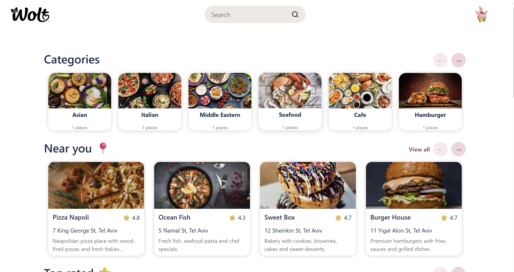
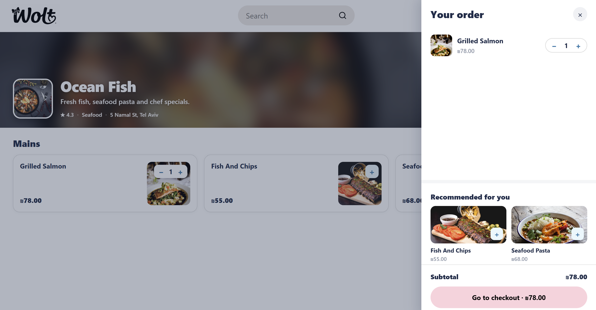
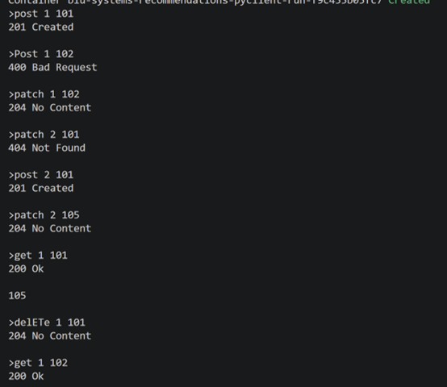

# BIU Systems – Recommendations

A Wolt style food delivery system in two parts:

- **Recommendation backend** (`backend/`)- a C++ TCP service that stores, per user, the
  set of products they have engaged with, and answers recommendation queries using
  collaborative filtering (ex2).
- **Web API** (`api/`)- an Express (Node.js) MVC REST server exposing users,
  restaurants, products, orders and search. It is the client of the recommendation
  backend: it opens a TCP socket to it and feeds it activity (ex3).

```text
client/HTTP -> Web API -> TCP -> Recommendation backend (C++)
```

---

# Wiki

* [Info on services supplied in this repo.](./wiki/services.md)
* [Native Build & Run instructions.](./wiki/build-run-native.md)
* [Docker Build & Run instructions.](./wiki/build-run-docker.md)
* [Examples - Web Client.](./wiki/examples-web.md)
* [Examples - Mobile Client.](./wiki/examples-mobile.md)

# Web frontend (ex4)

## Demo data (seed script)

Demo data for testing and demonstration is created by a seed script, `seed.js`. It is
**not** run automatically on startup - you run it manually against a running API. With the
MongoDB server and the API running, from the project root:

```bash
node seed.js
```

The script talks to the API over HTTP (`http://localhost:3000/api`) and is **idempotent
and non-destructive**: it only creates items that do not already exist, so it is safe to
re-run, never produces duplicates, and never deletes data you added manually.

Note: users, products, restaurants and orders are stored in MongoDB and survive an API
restart, so the seeded data persists. Re-running `node seed.js` is always safe (the
idempotent checks never create duplicates or delete data you added manually).

### Demo user
```text
Username: patrick
Password: 123456Aa
```

### Restaurants
The seed creates restaurants from the following categories:

- Cafe
- Italian
- Middle Eastern
- Seafood
- Asian
- Hamburger
- Vegan
- Dessert

Restaurants created:

- Morning Cafe
- Pizza Napoli
- Hummus Brothers
- Ocean Fish
- Thai Orchid
- Burger House
- Vegan Life
- Sweet Box

### Products
Example products:

- Pizza Margherita
- Coca Cola
- Pad Thai

### Orders
Some sample orders are created to demonstrate:

Order history

Restaurant recommendations

## screenshots
### Home Page


### Restaurant Page



# Web API (ex3)

A RESTful JSON API following an MVC structure. Users, products, restaurants and orders are
persisted in **MongoDB**, so the data survives an API restart.

## Architecture

```text
api/src/
  app.js                 entry point: parses args, wires the recommender, mounts routes
  backend.js             TCP client to the recommendation backend (get/post/patch/delete)
  db.js                  MongoDB (Mongoose) connection
  route/                 Express routers (one per resource)
  controller/            request handling + validation, one per resource
  model/                 data stores (storage injection. users, products, restaurants
                         & orders MongoDB-backed by default)
  middleware/auth.js     requireAuth/getAuthUserId
  service/recommender.js recommender interface + the real backend-backed implementation
```

Design notes:

- **MVC**: `route, controller, model`. Controllers validate input and shape responses,
  models hold state, routes only wire paths to handlers.
- **Loose coupling / dependency injection**: orders never call the backend directly. They
  depend on a `Recommender` interface (`service/recommender.js`). 
  At startup `app.js` injects the real, backend-backed recommender, tests inject a mock. 
  This keeps order logic decoupled from the network and lets the suite run without a live backend.
- **Storage injection**: each model exposes a `*Storage` interface with swappable backends.
  The user, product, restaurant and order models each ship a MongoDB/Mongoose backend (the
  default, so production persists with no extra wiring) and an in-memory backend that the
  test suite injects (so tests need no live database).
  This keeps the controllers unchanged and lets the data layer migrate without touching
  call sites.
- **Product ids are unique across the whole system**, so the recommender only needs
  `(user, products)` - the restaurant id is not sent to the backend.

## Authentication

Authenticated requests use JWT bearer tokens:

```text
Authorization: Bearer {token}
```

`requireAuth` verifies the JWT, extracts the logged-in user id, and rejects missing,
malformed or expired tokens with `401 Unauthorized`. Obtain a token by logging in with
`POST /api/tokens`. Protected routes are marked Auth below.

## Status conventions

| Code | Meaning |
|------|---------|
| `200 OK` | Success JSON body follows (`[]` for an empty collection) |
| `201 Created` | Resource created `Location` header points to it |
| `204 No Content` | Success no body |
| `400 Bad Request` | Malformed body, invalid value, or non-numeric id – `{ "error": ... }` |
| `401 Unauthorized` | Missing / invalid `user_id` on a protected route |
| `404 Not Found` | Resource does not exist – `{ "error": ... }` |
| `500 Internal Server Error` | An upstream call (the recommendation backend) failed |

Ids are numeric. Order timestamps are formatted `YYYY-MM-DD hh:mm`.
Note: response bodies on create/update differ per resource (documented below)-
restaurants and products echo the affected object, while users and orders return no body.


## Current data models

### User

```js
{
  id: number,
  username: string,
  password: string,
  name: string,
  image: string,
  location: { lat: number, lng: number },
  role: "owner" | "user"
}
```

### Restaurant

```js
{
  id: number,
  name: string,
  address: string,
  description: string,
  category: string,
  vegetarian: boolean,
  promoted: boolean,
  rating: number,
  imgURL: string,
  location: { lat: number, lng: number },
  owner?: number
}
```

### Product

```js
{
  id: number,
  name: string,
  price: number,
  category: string,
  pic: string
}
```

Products are stored under restaurants, but product ids are globally unique.
`category` must be one of: `Starters`, `Mains`, `Sides`, `Desserts`, `Drinks`.

### Order

```js
{
  id: number,
  user: number,
  restaurant: number,
  content: number[],
  created_at: "YYYY-MM-DD hh:mm",
  total: number,
  cancelled: boolean
}
```

Order totals are calculated from the saved product prices.

## Endpoints

### Users – `/api/users`

| Method | Path | Auth | Body | Success |
|--------|------|:----:|------|---------|
| `POST` | `/api/users` | – | `{ username, password, name, image, location, role? }` | `201` + `Location: /api/users/{id}` |
| `GET` | `/api/users/:id` | – | – | `200` + user (password omitted) |

`POST` = `400` if a field is missing/invalid or the username is taken.
`GET` = `404` if the user does not exist.

### Tokens (login) – `/api/tokens`

| Method | Path | Auth | Body | Success |
|--------|------|:----:|------|---------|
| `POST` | `/api/tokens` | – | `{ username, password }` | `200` + `{ token }` |

`400` for missing/non-string credentials, `401` for wrong username or password.

### Restaurants – `/api/restaurants`

| Method | Path | Auth | Body | Success |
|--------|------|:----:|------|---------|
| `GET` | `/api/restaurants` | – | – | `200` + array |
| `POST` | `/api/restaurants` | has | `{ name, address, description, category, vegetarian, promoted, rating, imgURL, location }` | `201` + `Location` + restaurant |
| `GET` | `/api/restaurants/:id` | – | – | `200` + restaurant |
| `PATCH` | `/api/restaurants/:id` | has | any restaurant fields except `id` | `200` + updated restaurant |
| `DELETE` | `/api/restaurants/:id` | has | – | `204` |

- A non-numeric `:id` = `400`. a missing restaurant = `404`.
- `PATCH` rejects unknown fields or non-string values with `400`.
- Deleting a restaurant is only allowed for their respective owners, also removes its products from the catalog.

### Products – `/api/restaurants/:id/products`

Products are nested under their restaurant (the router merges the parent `:id`).

| Method | Path | Auth | Body | Success |
|--------|------|:----:|------|---------|
| `GET` | `/api/restaurants/:id/products` | – | – | `200` + array |
| `POST` | `/api/restaurants/:id/products` | has | `{ name, price, category, pic }` | `201` + `Location` + product |
| `GET` | `/api/restaurants/:id/products/:pid` | – | – | `200` + product |
| `PATCH` | `/api/restaurants/:id/products/:pid` | has | any of `{ name, price }` | `204`, no body |
| `DELETE` | `/api/restaurants/:id/products/:pid` | has | – | `204` |

- Bad `:id`/`:pid` = `400`. unknown restaurant or product = `404`.
- Deleting a product also removes it from every user's list in the recommendation
  backend. if that backend call fails the response is `500`.

### Orders – `/api/orders`

All order routes require authentication and act only on the logged in user's own orders.

| Method | Path | Auth | Body | Success |
|--------|------|:----:|------|---------|
| `GET` | `/api/orders` | has | – | `200` + the user's orders |
| `POST` | `/api/orders` | has | `{ restaurant: number, content: number[] }` | `201` + `Location`, no body |
| `GET` | `/api/orders/:id` | has | – | `200` + order |
| `PATCH` | `/api/orders/:id` | has | `{ content: number[] } or { cancelled: boolean }` | `204`, no body, * |
| `DELETE` | `/api/orders/:id` | has | – | `204` |

- `content` must contain at least one product id. the restaurant and every product are
  validated against the catalog (`400` if empty, invalid, or unknown).
- `cancelled` marks an order as cancelled, 
 only applies if 15 minutes haven't passed from order creation.
  * on success, returns 200 instead of the default success status.
- Creating an order records the purchase in the recommendation backend, editing records
  the updated product list. If that backend call fails, the request returns `500`.
- An order owned by another user is reported as `404` (not `403`), so users can't probe
  each other's orders.

### Search – `/api/search`

| Method | Path | Auth | Success |
|--------|------|:----:|---------|
| `GET` | `/api/search/:query` | – | `200` + matching restaurants |

An empty/blank `query` = `400`.

## How the API talks to the recommendation backend

`backend.js` is a thin TCP client. For each call it opens a socket to the configured
`{host, port}`, sends a single line `"{method} {args...}"`, and parses the reply
`"{status} {reason}\n\n{value}\n"`. It exposes `get`, `post`, `patch`, `delete_`.

The recommender records a purchase **PATCH-first**: it appends the user's products with
`PATCH`. `204` means appended, `404` means the user has no list yet, in which case it
`POST`s to create one (`201`). Any other status, or a network error, surfaces as
`{ error }` so the controller can answer `500` instead of silently dropping the signal.
Duplicate product ids are removed before sending, since the backend stores a set per user.

Integrations in place:

- **Order create / edit** - records the user's purchased products.
- **Product delete** - removes that product from every user's list in the backend.

## Backend TCP protocol

The backend speaks a simple line protocol over the socket (this is what the Web API calls
internally. it is not the REST API above).

### Status codes

| Code | Meaning |
|------|---------|
| `200 Ok` | Request succeeded, response body follows |
| `201 Created` | Resource created successfully, no body |
| `204 No Content` | Request succeeded, no body |
| `400 Bad Request` | Malformed request, unknown command, or invalid operation |
| `404 Not Found` | Reserved for unknown command routes |
| `500 Internal Server Error` | Command failed unexpectedly on the server |

### Notes

- Parameters are delimited by spaces: `command argument1 argume nt2` parses as
  `"command", "argument1", "argume", "nt2"`.
- User data is saved in `./data/` (in Docker: `/usr/src/app/data`).
- Commands are case-insensitive: `POST`, `post`, and `Post` are equivalent.

### `POST {user} {products} ...`

Creates `user` with `{products} ...` as the initial list of items viewed.
Fails with `400 Bad Request` if `user` already exists.
Produces a `201 Created` response with no body.

### `PATCH {user} {products} ...`

Adds `{products} ...` to the list of items viewed by `user`.
Fails with `404 Not Found` if `user` does not exist.
Produces a `204 No Content` response with an empty body.

### `DELETE {user} {products} ...`

Deletes `{products} ...` from the list of items viewed by `user`.
Returns `204 No Content` on success, or `404 Not Found` if `user` does not exist.

### `GET {user} {product}`

Queries up to 10 heuristic-suggested items, drawn from the habits of other users who
viewed the most items in common. Returns `200 Ok` with the suggested items list.

### `help`

Returns all available commands and their argument syntax in alphabetical order (with
`help` last). Produces a `200 Ok` response with the help text.

### Examples

Input is denoted `> {input}`.

```
>post 1 101
201 Created

>Post 1 102
400 Bad Request

>patch 1 102
204 No Content

>patch 2 101
404 Not Found

>post 2 101
201 Created

>patch 2 105
204 No Content

>get 1 101
200 Ok

105

>delETe 1 101
204 No Content

>get 1 102
200 Ok
```

### Screenshot



## Open/Closed Principle Analysis

### Existing functionality modifications

#### Command Additions and Naming Changes

Changing command names required minor modifications to main.cpp, where commands are registered in the system, and unused command registrations had to be removed from main.cpp. However, the command implementations themselves remained unchanged.
So the Open/Closed Principle was preserved as main.cpp is not the core application logic.
The original design from Ex1 was based on the Command pattern and used a map that mapped command names to command objects in memory. Commands were executed through `Command` base class, where `CommandManager` invoked the appropriate command by calling its `apply()` method through a stored pointer. Because of this structure, changing command names only required updating the command mapping, while the command implementations themselves remained unchanged.

#### Adding New Commands (POST, PATCH, DELETE, GET)

Adding the new HTTP-style commands required only:
- Creating new `Command` subclasses (`Post`, `Patch`, `Delete`, `Get`)
- Registering them in `main.cpp` using `mgr.add(...)` - a single line per command

`GET` reused the existing `Recommend` implementation and therefore did not require any logic changes.
`POST` and `PATCH` reused the existing `Add` functionality and only required adding user existence validation according to the updated requirements.

No changes were made to `CommandManager`, the `Command` base class. The Open/Closed Principle was preserved - the system was open for extension through new `Command` subclasses and closed against modification of the core logic.

#### Output Format Changes

The requested change affected only the output format. The core logic itself remained unchanged, the functions compute the same result, and only the formatting was adjusted to match the updated requirements.

#### Console to socket based communication

Changing the I/O from console to socket based communication didn't require changes to the commands, they remained responsible only for their intended functionality.
The communication handling was implemented outside the command logic, in a shared function.

---

## Project Structure

```text
backend/    recommendation backend service (C++ TCP)
api/        ExpressJS REST API server (MVC)
  src/
    app.js                 entry point + wiring
    backend.js             TCP client to the backend
    db.js                  MongoDB (Mongoose) connection
    route/                 users, tokens, restaurants, products, search, orders
    controller/            validation + responses per resource
    model/                 data stores (users, products, restaurants & orders
                           MongoDB-backed. storage injection)
    middleware/auth.js     authentication
    service/recommender.js recommender interface + backend-backed impl
  test/                    API tests (node --test)
seed.js     idempotent demo-data seeder (run manually against a running API)
client/     clients
data/       data storage
```

## Work Process

The project was developed using an organized Git and Jira workflow.

Development was managed through Jira, where the project was divided into epics, sprints, and individual tasks. Each feature or bug fix was tracked using a Jira issue, allowing us to split the work between the team members.

For version control, we used a feature-branch workflow. Each Jira task was implemented on a dedicated branch created from `main`, keeping changes focused and easier to review.

After completing a task, the changes were submitted through a Pull Request. Each PR was reviewed and approved by each team member before being merged into `main`, helping maintain code quality and consistency.