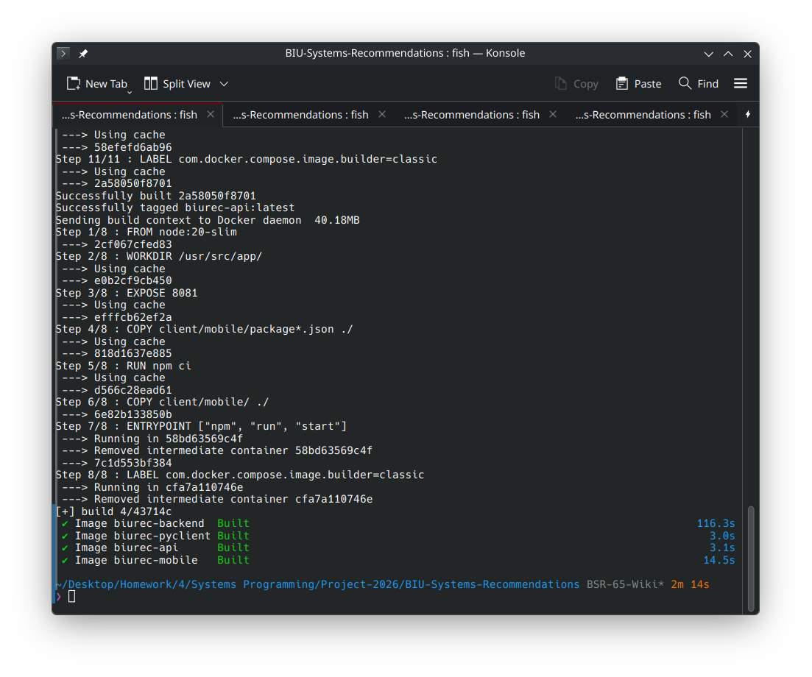
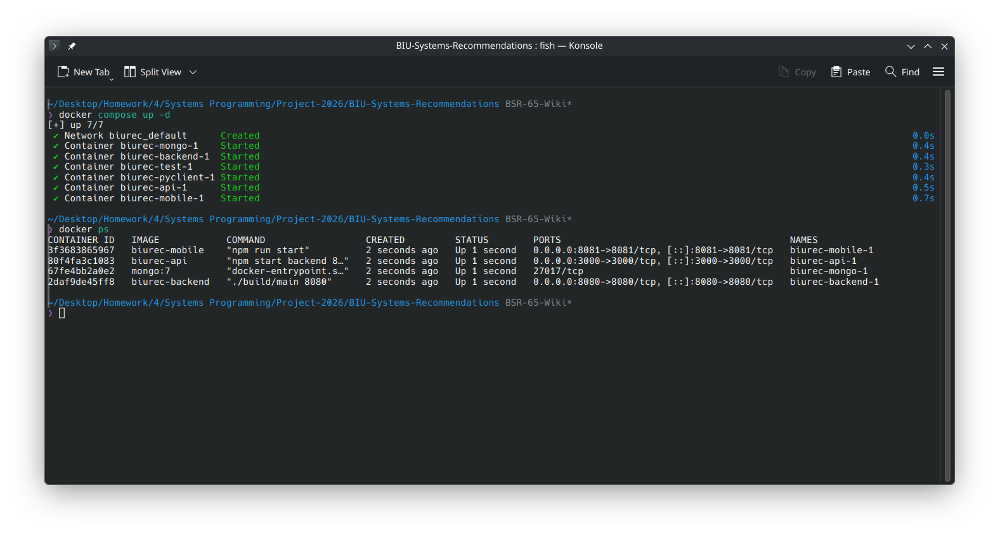
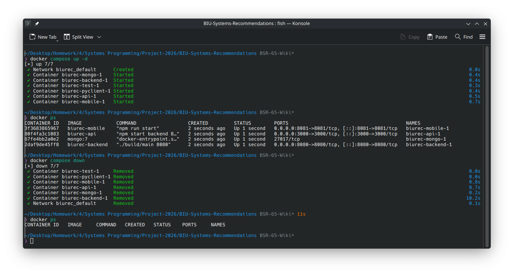
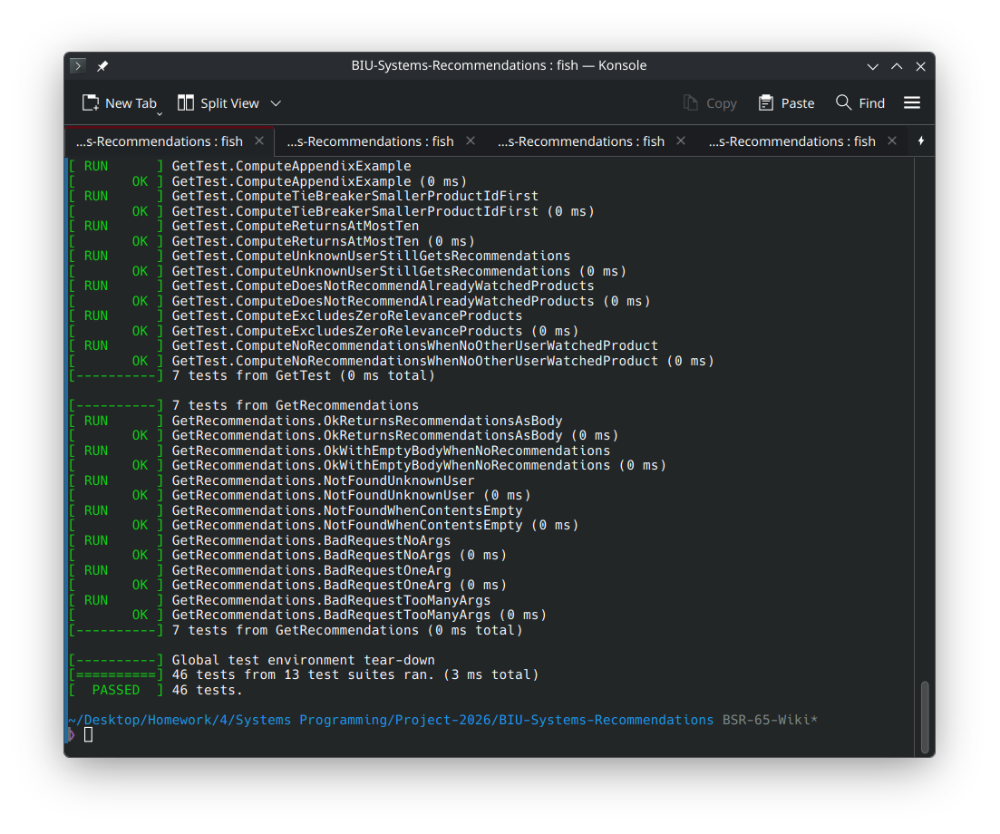
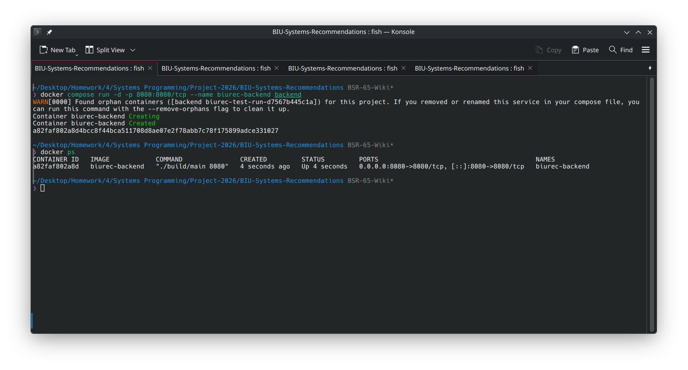
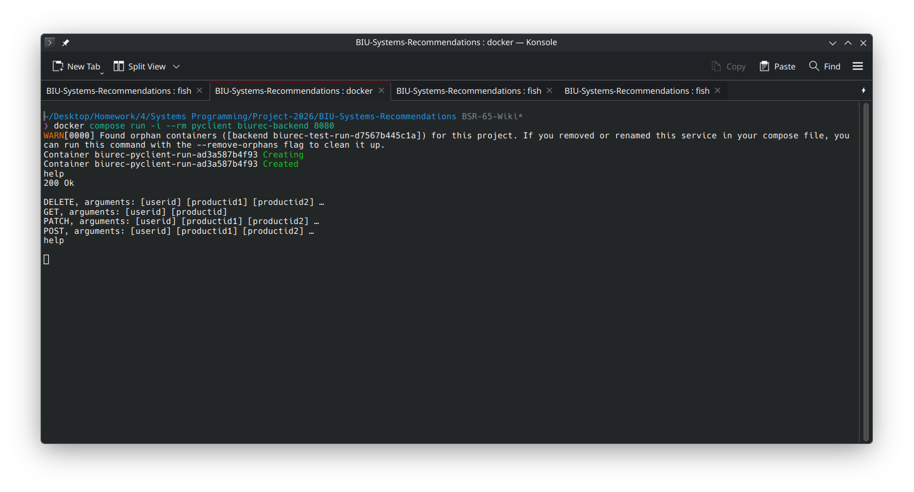
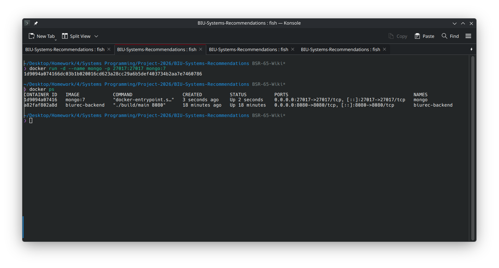
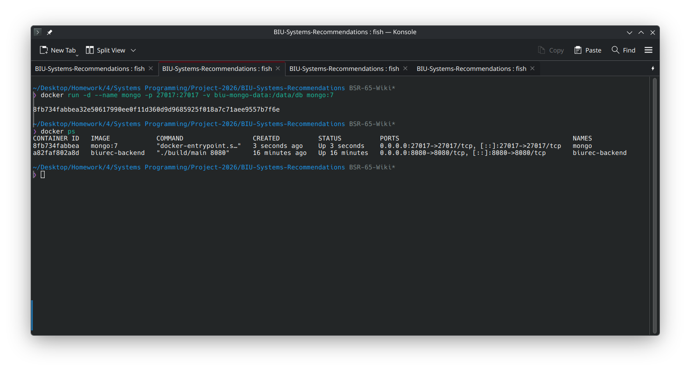
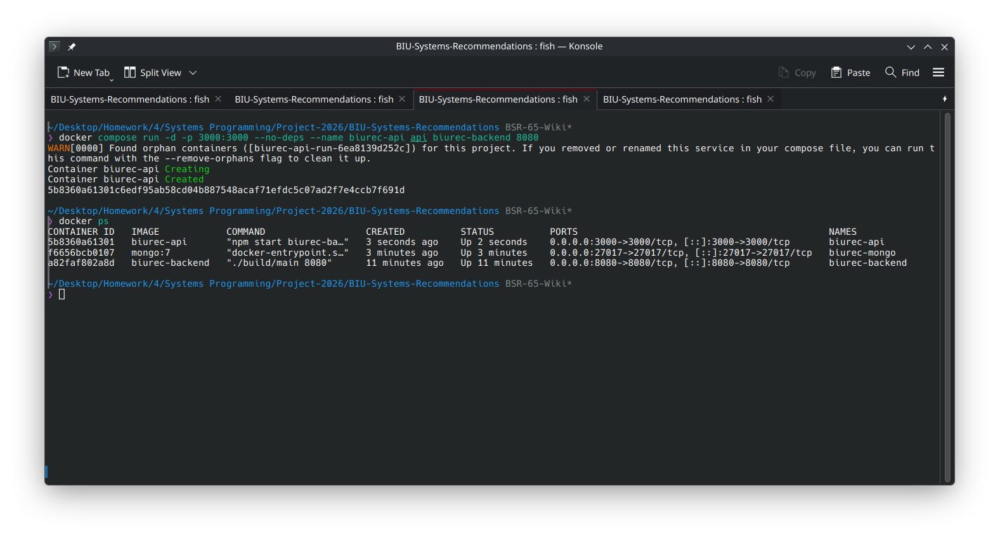
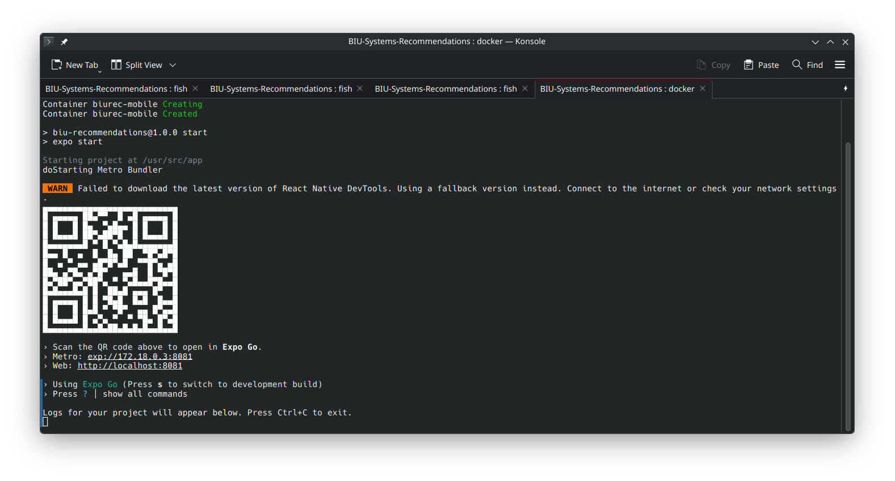

# Building & Running using Docker

All services supplied in this project follow the following naming convention: `biurec-{service}`.

## Building

Build all images using:
```bash
docker compose build
```



## Running Services

### Everything at once

All of the services at once, with a default configuration can be ran with:

```bash
docker compose up -d
```




- `backend` - runs on port 8080.
- `mongo` - runs on port 27017.
- `api` - runs on port 3000.
- `mobile` - runs on port 8081.

Stop all services with:

```bash
docker compose down
```



Note: The next sections cover running these same services individually.

### Backend

Run Backend service tests in foreground:
```bash
docker compose run test
```




Run Backend service in background:
```bash
docker compose run -d -p {port}:8080/tcp --name {service} backend
```



- where `port` is the port this service will listen on.
  - if unsure: 8080
- where `service` is the container name, and also the hostname that will be available to other containers **if they are running using docker on the same machine**.
  - if unsure: backend

### Backend Client

Run client once in foreground, and remove automatically:
```bash
docker compose run -i --rm pyclient {backend_service} {backend_port}
```



- where `backend_service` is the container name of the backend service, or IP address of the machine running said service.
- where `backend_port` is the port the backend service is listening on.
- note: as this is a client mostly used in testing, 
the expected usecase is this should not keep running in the background after a keyboard interrupt (`ctrl+c`).

### MongoDB

This is used by the `api` service for data persistence.
The `api` service connects to `MONGO_URI`, defaulting to `mongodb://127.0.0.1:27017/biu`.

Run MongoDB service in background:

```bash
docker compose run -d -p 27017:27017 --name mongo mongo
```



Data persists until the `mongo` container is removed, unless a volume was mounted, and we ran the next command instead.

Run MongoDB service in background with a volume:
```bash
docker compose run -d --name mongo -p 27017:27017 -v biu-mongo-data:/data/db mongo
```



* Note: native run instructions are omitted, as the developer team used docker to deploy the database.

If not running a database using these instructions, set the following variable to the actual database's URI before starting the `api` container:

```bash
# Linux/macOS
MONGO_URI="mongodb://127.0.0.1:27017/biu"

# Windows PowerShell
$env:MONGO_URI="mongodb://127.0.0.1:27017/biu"
```

* The default is given in this example: `"mongodb://mongo:27017/biu"`.

If this service is not running when `api` is initializing, it will spawn this service itself.

### API & Web Service

Run API & Web service in background:
```bash
docker compose run -d -p {port}:3000 [--no-deps] --name biurec-api api {backend_service} {backend_port}
```



where:
- `port` is the port this service may be accessed through.
- where `backend_service` is the container name of the backend service, or IP address of the machine running said service.
- `backend_port` is the port the `biurec-backend` service is listening on.

### Mobile Service

Run Mobile service in foreground:
```bash
docker compose run -i -p {port}:8081 --name biurec-mobile [--no-deps] mobile
```



where:
- `port` is the port this service may be accessed through.
- if `--no-deps` is not specified, services `backend`, `mongo` launch with default arguments (Port & URI).

after which, pressing ? will bring up this list of available commands:

```
› Press s │ switch to development build

› Press a │ open Android
› shift+a │ select an Android device or emulator
› Press w │ open web

› Press r │ reload app
› Press j │ open debugger
› Press m │ toggle menu
› shift+m │ more tools
› Press o │ open project code in your editor
› Press c │ show project QR
```

Note: to run with an android emulator, this service needs to run natively.
