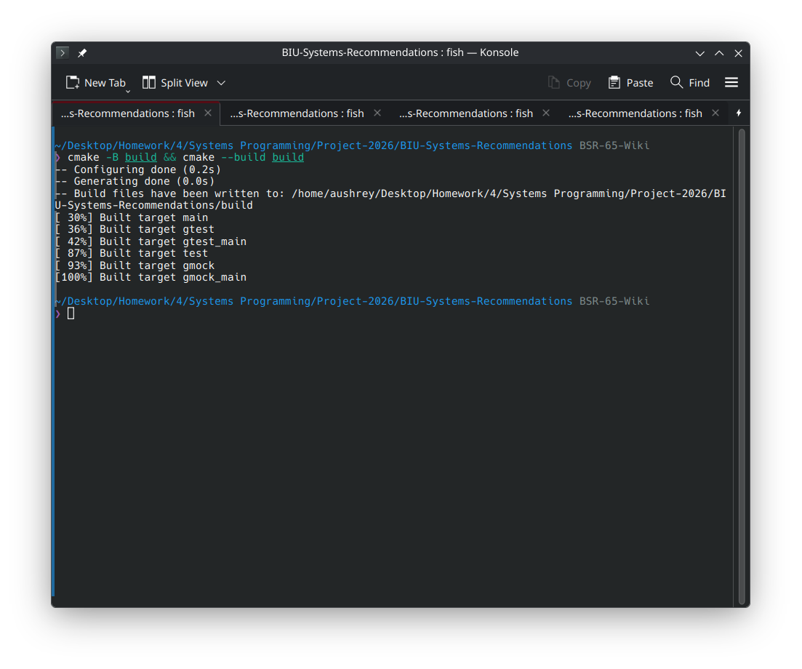
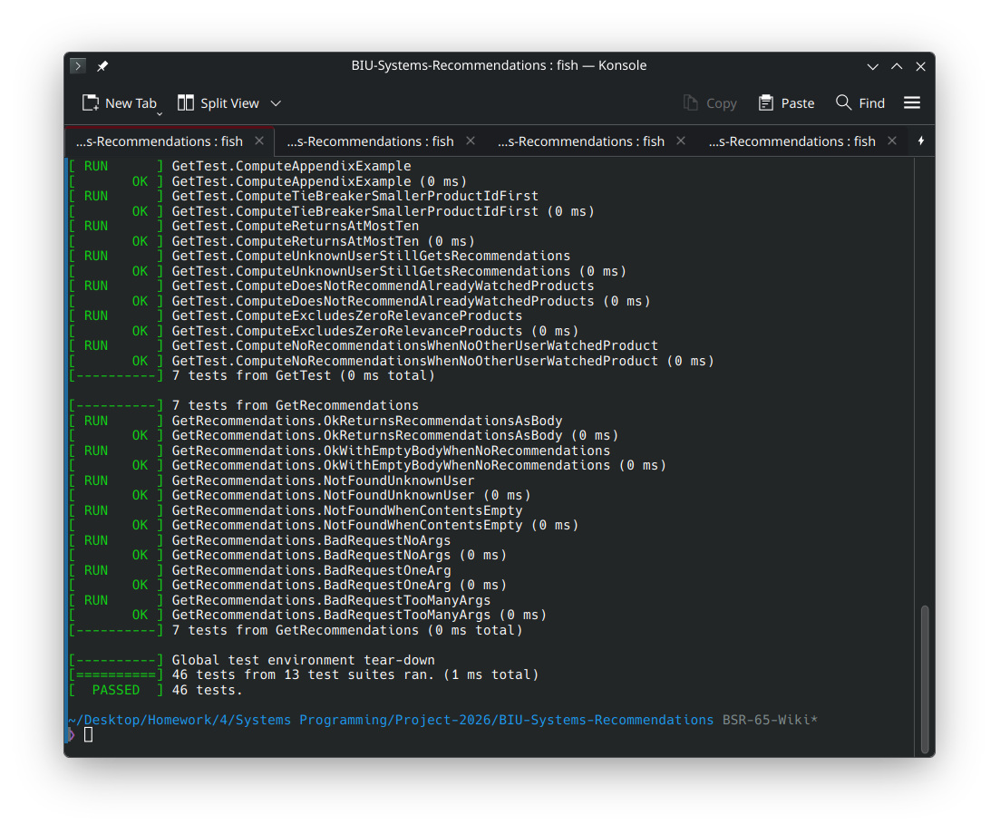
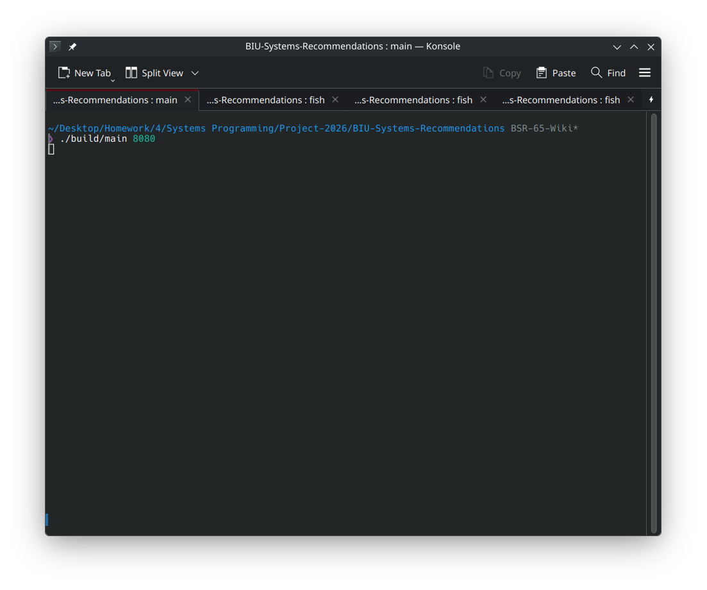
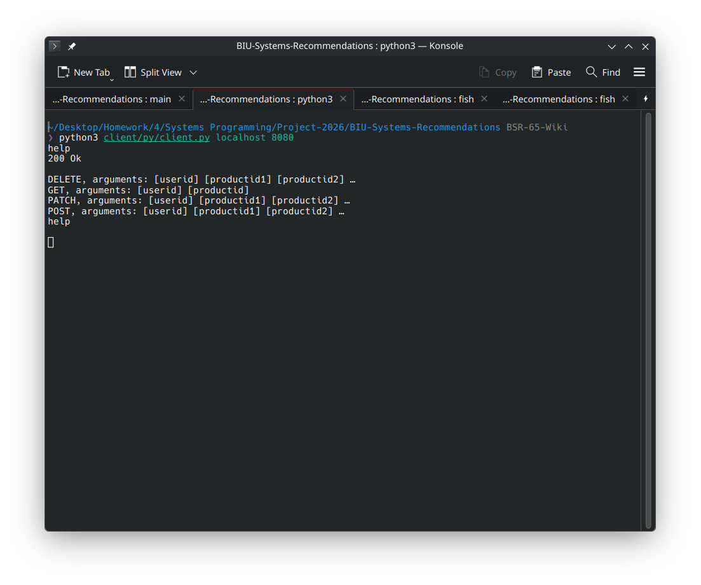
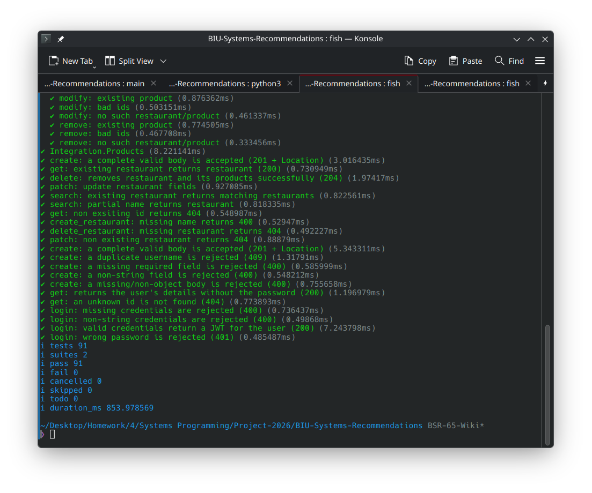
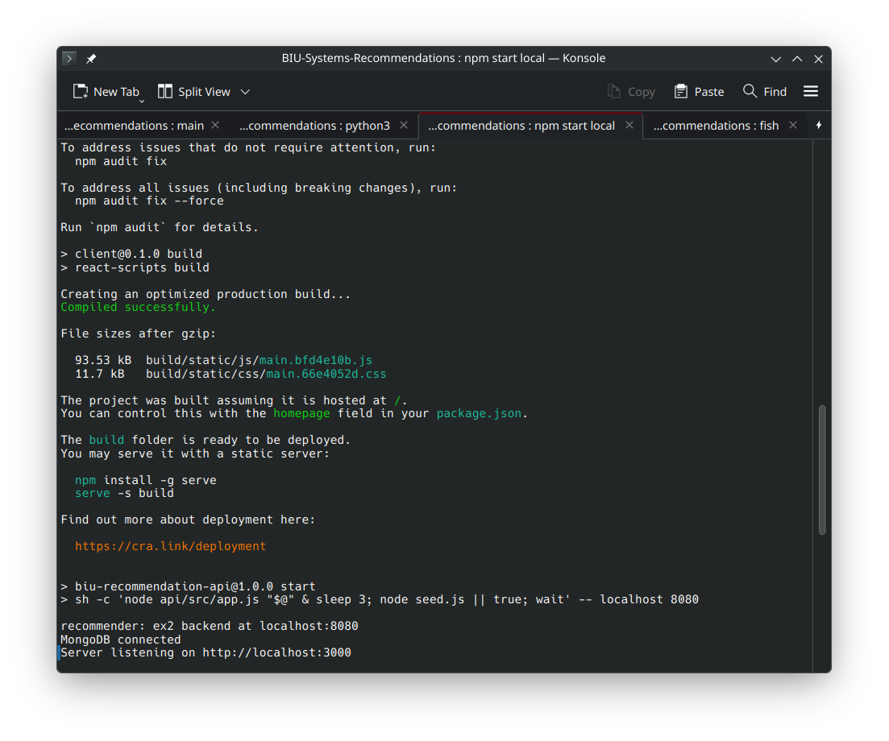
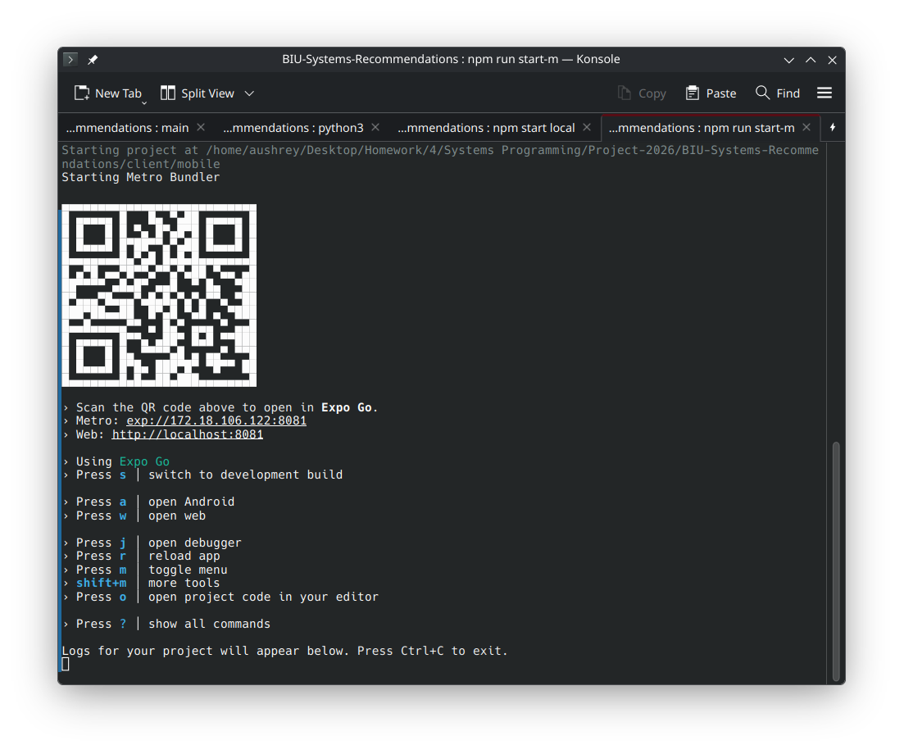

# Building & Running Natively

## Backend Service (supported only on linux)

Built with cmake and make:

```bash
cmake -B build && cmake --build build
```



Run the tests:

```bash
./build/test
```



Run the service:

```bash
./build/main {port}
```



* note this has no output, this can be stopped via keyboard interrupt (`ctrl+c`).
* note that the `host` for this machine, and `port` for this service, 
should be given to the **API & Frontend** service, if running locally `host` will be `localhost`, 
otherwise use the IP address of this machine.

## Backend Client

Run client once in foreground, and remove automatically:
```bash
python ./client/py/client.py {backend_service} {backend_port}
```



- where `backend_service` is the container name of the backend service, or IP address of the machine running said service.
- where `backend_port` is the port the backend service is listening on.
- note: as this is a client mostly used in testing, 
the expected usecase is this should not keep running in the background after a keyboard interrupt (`ctrl+c`).

## API & Frontend Service

* Running this requires the `mongo` docker image to be running.
  * See `mongo` under [Docker Build & Run instructions.](./build-run-docker.md).

Test with:
```bash
npm run test
```



Run with:
```bash
npm ci && npm run build && npm start {host} {port}
```




where `host`, `port` are from the earlier section. 
this tells the service how to connect to the backend.

* note - this automatically runs a `seed` script which adds mock data.

## Mobile Service

* Running this requires the `api` service to be running.

Run with:
```bash
npm run start-mobile
```



after which, pressing ? will bring up this list of available commands:

```
› Press s │ switch to development build

› Press a │ open Android
› shift+a │ select an Android device or emulator
› Press w │ open web

› Press r │ reload app
› Press j │ open debugger
› Press m │ toggle menu
› shift+m │ more tools
› Press o │ open project code in your editor
› Press c │ show project QR
```
