# Examples - Mobile Client

Note: the first section is given in dark theme, while the second is in light theme, this is because i changed my system-preferred theme in order to showcase this feature.

## Logging in

Opening the App we're met with the following home page:

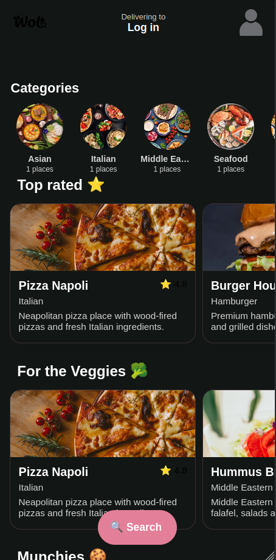

In this example i'll log in using an existing account, we'll log in by pressing the profile button at the top right:

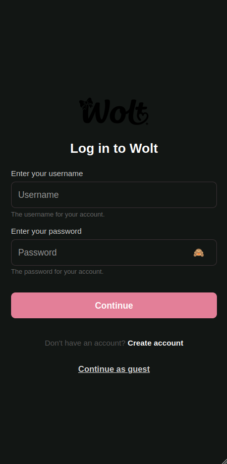

We'll fill in our details:

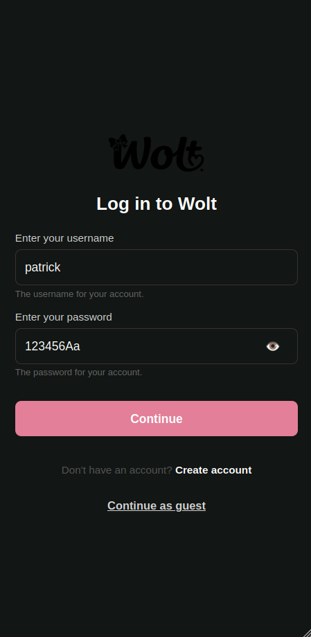

And Continue back to the main page:

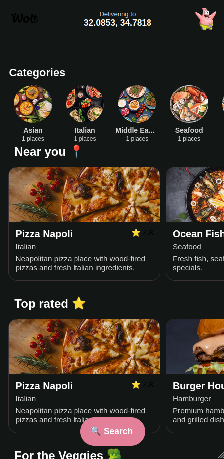

## Checking order history

Pressing the profile button again we're met with the following:

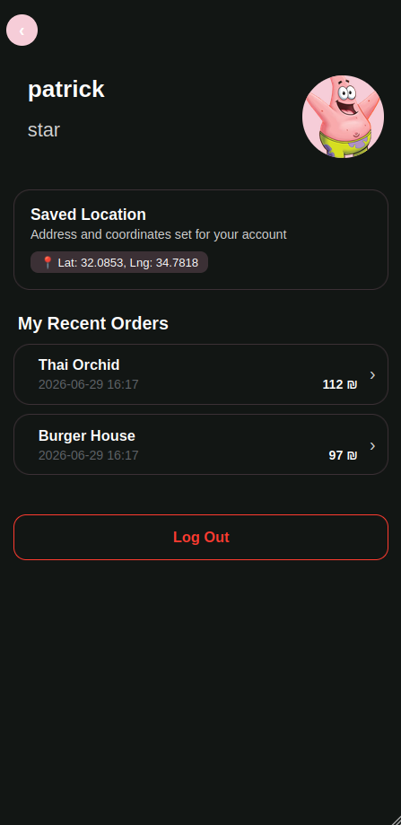

Let's check what we've ordered from 'Thai Orchid':

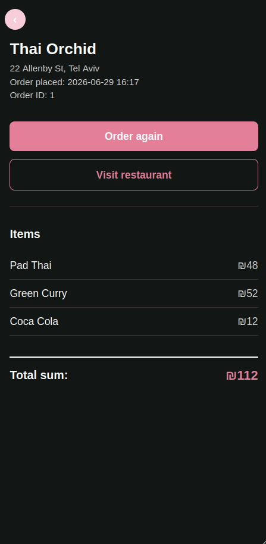

## Placing an order

### Querying for a restaurant

Back on the home page, we'd like to lookup a restaurant by name, pressing the search button we see the following:

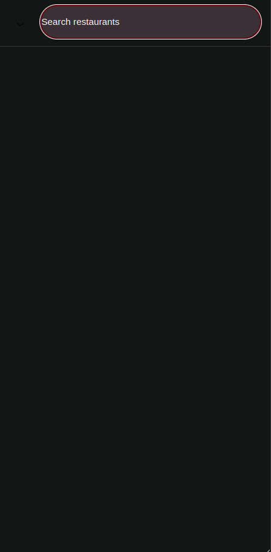

Typing the name of the restaurant:

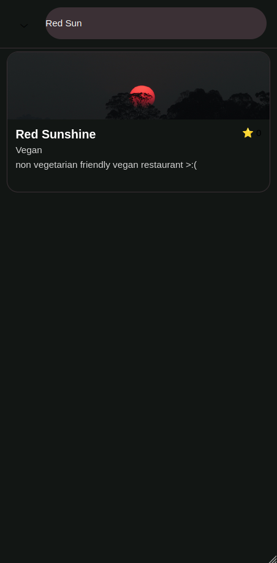

### Placing the order

Pressing the above card, we're led to the restaurant's page:

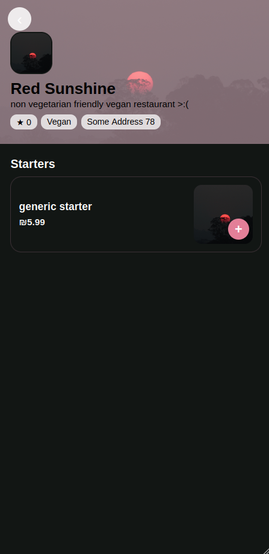

We'll grab three of these starters:

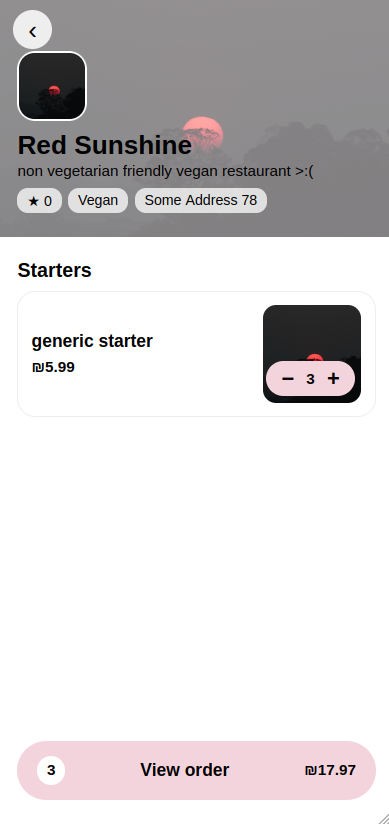

Actually three is too much, two is enough:

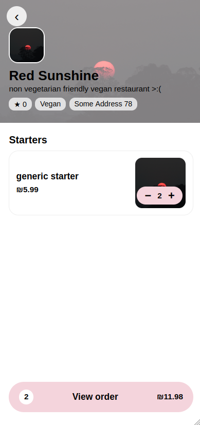

And view our order:

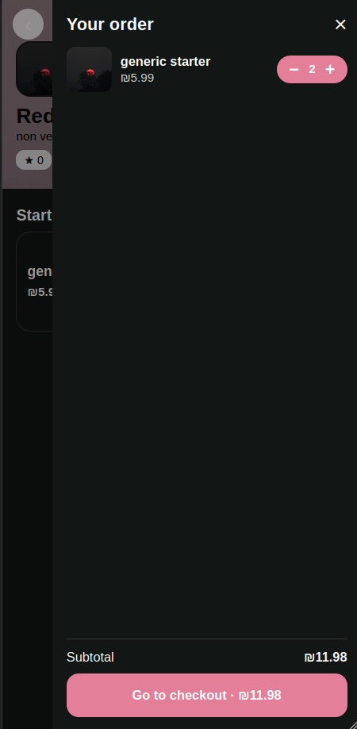

Then, go to checkout:

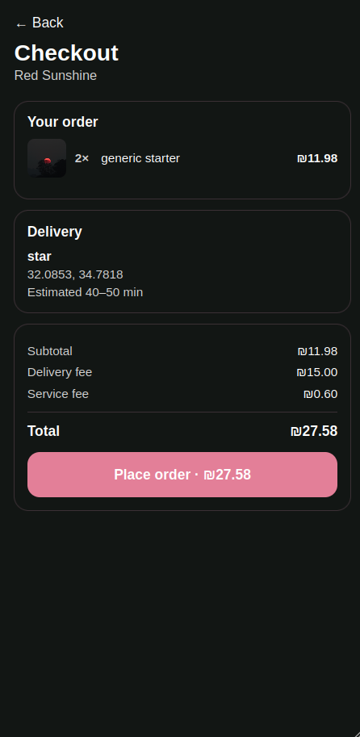

Finally, place our order:

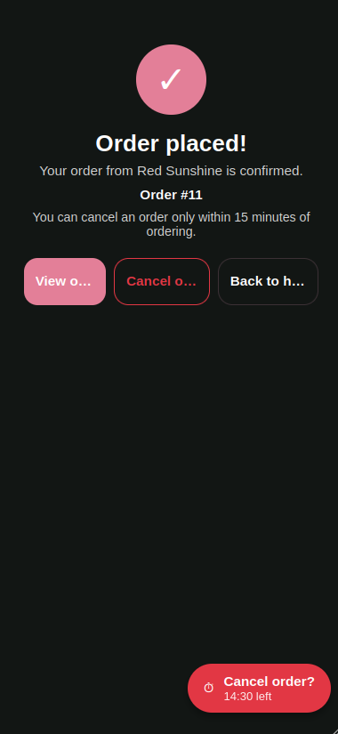

## Cancelling an order

Having decided we want to cancel our order, we press the 'cancel order' button in the center:

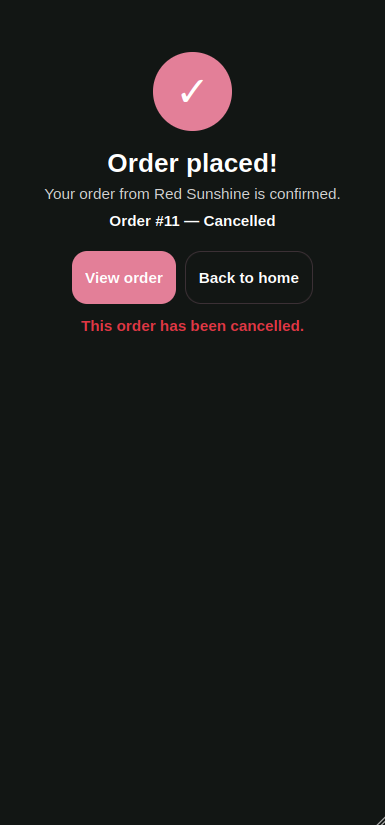

## Creating a restaurant

### Creating a restaurant owner account

Logging out in the profile, and choosing to create a new account at the login, we fill the details to create a restaurant owner account.

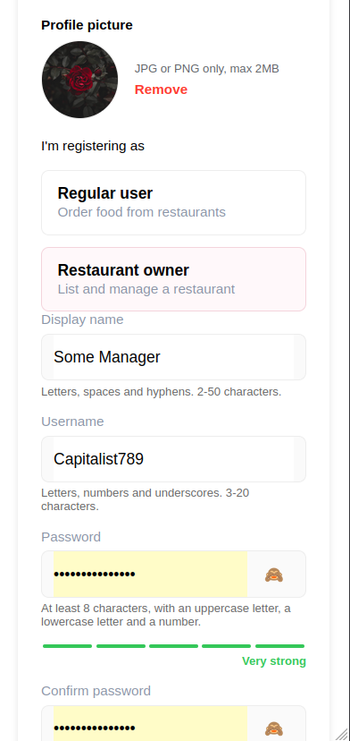

After which we are welcomed to the following screen:

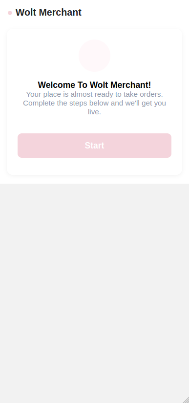

Proceeding, we are tasked with filling out the details of our restaurant:

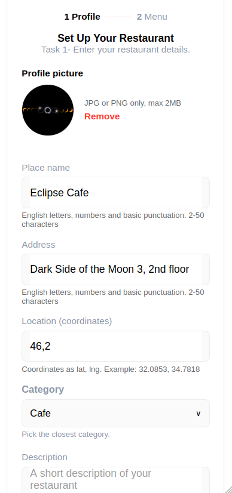

And then to fill out a menu of products, we add a coffee:

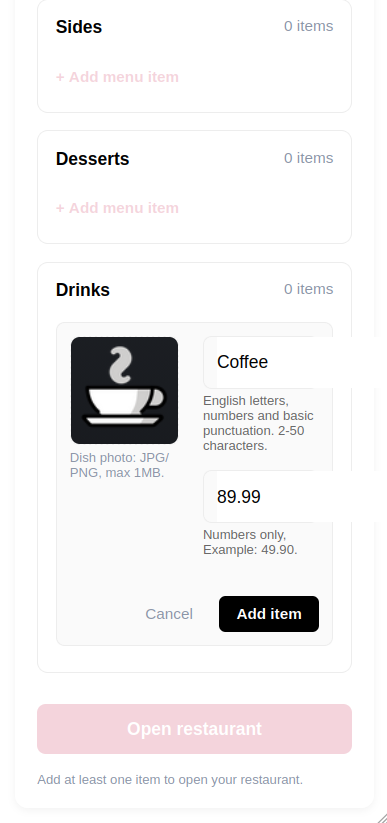

Creating the restaurant, we're placed in the home page where sure enough:

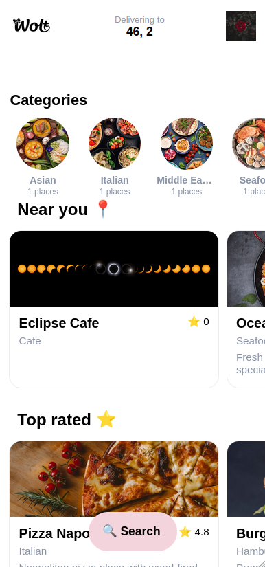

## Editing a restaurant

Let's head into the restaurant and change a few things.

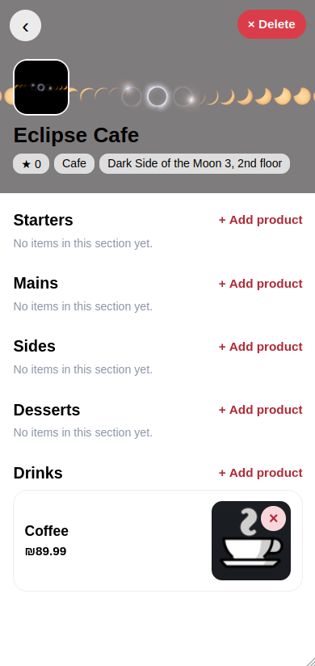

### Adding product

Let's add a product, pressing '+ Add product' and filling the details:

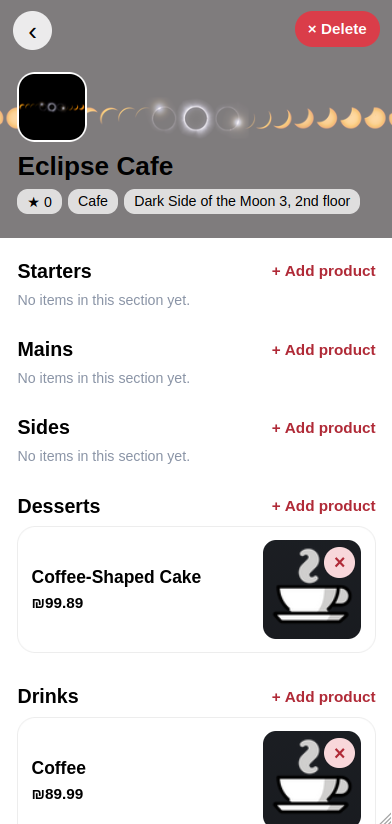

### Removing a product

Now pressing the '(x)' button removes it:

## Removing a restaurant

Let's get rid of this restaurant, by pressing the (x delete) button:

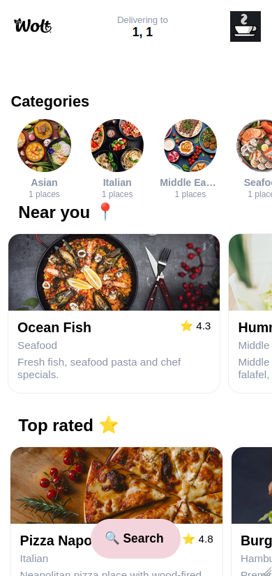

